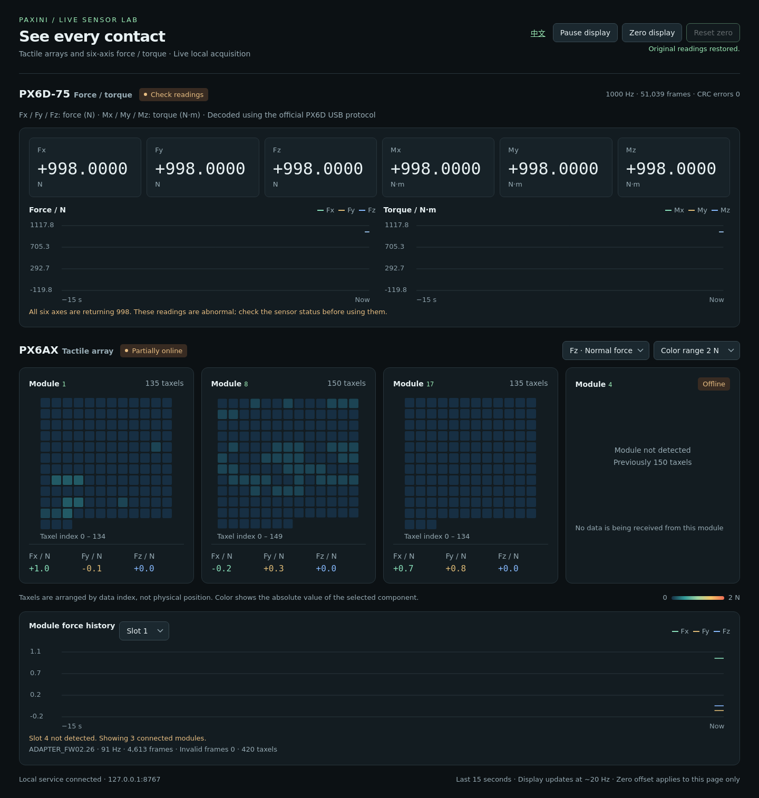

# PaXini Live Sensor Viewer

**English** | [简体中文](README.zh-CN.md)

A local browser dashboard for PaXini tactile arrays and a PX6D-75 USB force/torque sensor. The acquisition server runs on the computer connected to the hardware.



## Open the installed viewer

On the configured workstation, log in, connect the tactile adapter over USB, and open:

| View | URL |
| --- | --- |
| English dashboard | <http://127.0.0.1:8767/> |
| English tactile section | <http://127.0.0.1:8767/#taxtitle> |
| Chinese dashboard | <http://127.0.0.1:8767/zh> |
| Chinese tactile section | <http://127.0.0.1:8767/zh#taxtitle> |

The user service is already enabled on this workstation. It starts after login and reconnects when a matching USB device appears. Opening or closing the browser does not start or stop acquisition. Tactile viewing works with the PX6D disconnected.

If the page does not open, run these commands from any directory:

```bash
systemctl --user start paxini-live.service
xdg-open 'http://127.0.0.1:8767/#taxtitle'
```

## Features

- Per-module tactile resultant forces and per-taxel heatmaps.
- Selectable Fx, Fy, Fz or force-magnitude heatmaps and color ranges.
- PX6D force Fx/Fy/Fz in N and torque Mx/My/Mz in N·m.
- Rolling 15-second charts, display pause, display zero and reset.
- English and Chinese interfaces, linked from the page header.
- USB discovery, reconnect, stale-data indicators and missing-module cards.

## Requirements

- Linux with `/dev/serial/by-id`; this application has been exercised on Ubuntu. Device discovery and the service installer target Linux.
- Python 3.10+ with `venv`, `pip`, and USB serial access.
- A modern browser. No Node.js or frontend build is required.
- For login autostart: a working `systemd --user` session.

The tested USB devices use Linux's built-in `cdc_acm` driver. If serial access is denied on Ubuntu, check `id -nG`. An administrator can grant access with:

```bash
sudo usermod -aG dialout "$USER"
```

Log out and back in after changing group membership. Install Python's `venv` package if `python3 -m venv` is unavailable.

## First run from a checkout

From the repository directory:

```bash
./setup.sh
./run.sh
```

`setup.sh` creates `.venv/` and installs [requirements.txt](requirements.txt). To select an interpreter, use `PAXINI_PYTHON=/path/to/python3 ./setup.sh`.

Keep the terminal open, then visit <http://127.0.0.1:8767/>. Press Ctrl+C to stop the foreground server. Hardware may be absent at startup; each device reconnects independently when plugged in.

If the user service is running, stop it before starting a foreground server:

```bash
systemctl --user stop paxini-live.service
./run.sh
```

Only one process should read these serial devices. Changing the HTTP port does not permit two simultaneous hardware readers. To change the web port, use `./run.sh --port 8768` after stopping the other reader.

## Start automatically after login

After setup, run:

```bash
./scripts/install-service.sh
```

The installer generates the service using the checkout's actual absolute path, writes `~/.config/systemd/user/paxini-live.service`, reloads the user service manager, and enables/starts the service. It needs no root privileges and does not open a browser automatically.

To inspect the generated unit without installing it:

```bash
./scripts/install-service.sh --print
```

| Task | Command |
| --- | --- |
| Check status | `systemctl --user status paxini-live.service` |
| Start | `systemctl --user start paxini-live.service` |
| Restart acquisition | `systemctl --user restart paxini-live.service` |
| Stop | `systemctl --user stop paxini-live.service` |
| View logs | `journalctl --user -u paxini-live.service -n 50 --no-pager` |
| Disable autostart and stop | `systemctl --user disable --now paxini-live.service` |

After moving the checkout, run the installer again, then restart the service. After changing running backend code, restart the service. The template is [systemd/paxini-live.service.in](systemd/paxini-live.service.in).

## Using the visualization

1. Connect the tactile modules to the high-speed board and connect the board to USB. Connect a PX6D separately when needed.
2. Open the tactile section. `Live` means the stream is fresh. `Partially online` means some expected modules are missing; check the cards and status text.
3. Choose a heatmap component and color range. The module selector chooses the three-axis resultant-force history to display.
4. `Pause display` freezes the view while acquisition continues.
5. `Zero display` subtracts the current readings in this browser page. `Reset zero` restores original readings. These buttons do not send hardware calibration commands.
6. Use `中文` or `English` in the header to switch interfaces. Switching pages clears browser-local zero offsets and chart history.

Heatmaps arrange taxels by communication index, **not physical sensor coordinates**. Color shows the absolute value of the selected component, or the three-axis force magnitude. Fx/Fy/Fz numeric values retain their signs.

## Device discovery and configuration

The server searches these stable USB paths instead of fixed `/dev/ttyACM0` numbers or a particular chip serial number:

| Device | `/dev/serial/by-id` pattern |
| --- | --- |
| Tactile high-speed adapter | `usb-PaxiniAdapte3_Paxini__Adapter_*-if00` |
| PX6D USB interface | `usb-GigaDevice_GD32-CDC_ACM_*-if00` |

Discovery assumes one matching device of each type. Multiple matches produce an explicit ambiguity error. The generic GD32 USB name alone does not establish compatibility with other products: the driver expects PX6D frames and default device address `0x7F`.

The known-slot map in `Tactile.collect()` is specific to this installation:

| Expected slot | Previously reported taxels |
| --- | ---: |
| 1 | 135 |
| 4 | 150 |
| 8 | 150 |
| 17 | 135 |

Actual online slots and counts are read from the board. The map determines missing-module warnings; update it for a different physical layout. A 150-taxel module's exact model has not been inferred. Patterns and the slot map live in [server.py](server.py); there is no separate configuration file.

## Data and protocol

- Tactile communication/decoding use the vendored community [paxini-sdk](https://github.com/Jingyi-Z/paxini-sdk), commit `79c82145f88e158dd7706736e8c07f14f11cbd7a`, with its 0.1 N/LSB conversion rules.
- PX6D has a separate official-protocol driver: 921600 baud, 8N1, six little-endian float32 values, and CRC-8 polynomial `0x07`, initial value 0.
- PX6D firmware `v1.1.0` sends a 13-byte start acknowledgement before 29-byte measurement frames; the parser handles both.
- Observed host reception rates on this bench were about 91 Hz for tactile and 1000 Hz for PX6D. Other configurations may differ.
- The browser receives the latest snapshot at about 20 Hz. This app does not provide full-rate CSV recording.
- Device threads run independently without hardware timestamp synchronization.
- Data older than 0.5 seconds is marked stale. Disconnects/timeouts trigger reconnect attempts. CRC validity does not establish measurement validity or a complete device self-diagnostic result.

The backend listens on `127.0.0.1`. `GET /api/status` returns states, rates, counters and latest data; `/ws` streams JSON snapshots. These addresses belong to the computer running the server.

## Known hardware status and limits

A bench check on 2026-11-23 received tactile slots 1, 8 and 17: 420 taxels, about 91 Hz, no observed frame errors. Slot 4 was not detected. This is a dated observation; use the live page for current status.

A connected PX6D returned six constant `998` values, including direct single-frame reads. Independent decoding with the vendor application's float-reading logic gave the same result. The readings persisted after unloading and a one-time documented hardware zero command returned success. The cause remains unresolved: this does **not** establish physical sensor damage or a real load of 998 N/N·m. The UI marks these readings abnormal and excludes them from display-zero capture. The normal service does not automatically perform hardware zeroing/calibration.

Workstation captures/session notes stay local in `docs/diagnostics/` and `docs/local-session-notes.zh-CN.md`, excluded from Git. Vendor PDFs/installers are also local-only. Official sources:

- [PaXini support/download center](https://www.paxini.com/cn/developer)
- [PX6D user manual](https://cdn-cn.paxini.com/store/pro/unknown/5cda08c8-aa4f-4a07-8c9a-bcbb6413a229.pdf)

## Troubleshooting

| Symptom | Action |
| --- | --- |
| Connection refused in browser | Start/check the user service, then open the local URL. |
| Page opens but data stops updating | Resume a paused display, check USB, then restart the service if needed. |
| Serial `Permission denied` | Check device permissions and `dialout`; log in again after changes. |
| Web port in use or serial device locked | Stop the duplicate server, vendor tool or other serial reader. |
| A tactile module is missing | Check the missing-slot message, connections and the installation-specific slot map. |
| Multiple matching USB devices | Connect one of each type or adapt discovery to select the intended device explicitly. |
| PX6D shows six `998` values | Treat the readings as abnormal; preserve raw evidence and confirm the device state with the manufacturer or a known-good comparison. |

## Development and repository contents

Run offline tests without a connected sensor:

```bash
.venv/bin/python -m unittest -v test_protocol
```

Tests cover vendor examples, fragmented/corrupt frames, startup acknowledgements, non-finite values, and discovery after USB serial identity changes. Browser/live-device checks are separate.

```text
server.py                       Acquisition, frame parsing, HTTP/WebSocket server
index.html / index.zh.html      English / Chinese dashboards
setup.sh / run.sh               Setup / foreground launcher
scripts/install-service.sh      Install the login service for this checkout
systemd/paxini-live.service.in  Portable user-service template
requirements.txt               Runtime dependencies
test_protocol.py               Offline protocol/discovery tests
vendor/                        Tactile SDK and preserved license
docs/preview*.png               Screenshots
README.md / README.zh-CN.md     English / Chinese documentation
```

See [third-party notices](THIRD_PARTY_NOTICES.md) for provenance and licensing. Virtual environments, logs, hardware captures and downloaded vendor documents are excluded from Git.
