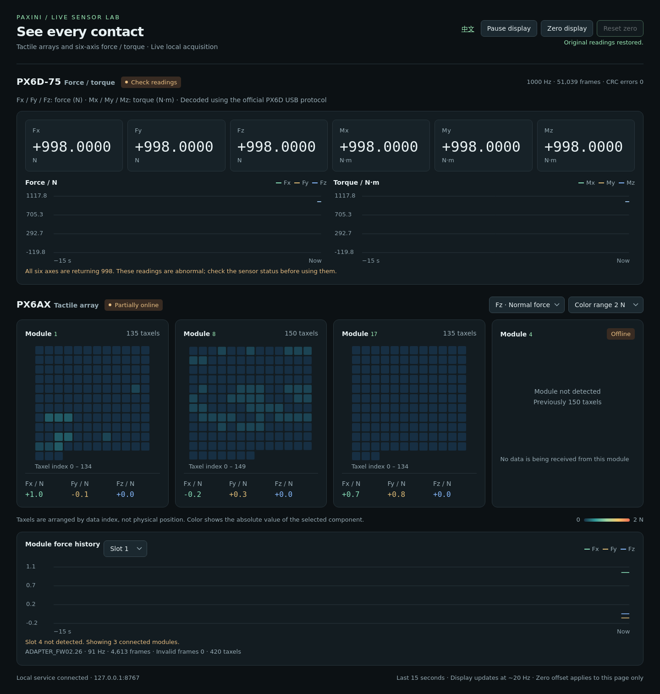

# PaXini 实时传感器可视化

[English](README.md) | **简体中文**

通过本机浏览器查看 PaXini 触觉阵列和 PX6D-75 USB 六维力传感器。采集服务运行在连接硬件的电脑上。



## 已安装电脑：直接打开

在已配置好的电脑上登录系统，接好触觉 USB，然后打开：

| 界面 | 地址 |
| --- | --- |
| 英文首页 | <http://127.0.0.1:8767/> |
| 英文触觉区域 | <http://127.0.0.1:8767/#taxtitle> |
| 中文首页 | <http://127.0.0.1:8767/zh> |
| 中文触觉区域 | <http://127.0.0.1:8767/zh#taxtitle> |

本机已启用用户服务，登录后自动启动，插入匹配的 USB 设备后会自动连接。打开或关闭浏览器不会启停采集。只看触觉时无需连接 PX6D。

若页面打不开，在任意目录打开终端执行：

```bash
systemctl --user start paxini-live.service
xdg-open 'http://127.0.0.1:8767/#taxtitle'
```

## 功能

- 各触觉模块的三轴合力和每个触觉点的热图。
- 可选 Fx、Fy、Fz、三轴力大小及颜色量程。
- PX6D 三轴力 Fx/Fy/Fz（N）和三轴力矩 Mx/My/Mz（N·m）。
- 最近 15 秒曲线、暂停显示、显示归零和恢复原始值。
- 中英文界面，顶部提供语言切换链接。
- USB 自动发现、断线重连、过期数据提示及缺失模块卡片。

## 环境要求

- Linux，具有 `/dev/serial/by-id`；已在 Ubuntu 上实际使用，设备发现和服务安装脚本面向 Linux。
- Python 3.10 或更高版本、`venv`、`pip`，以及 USB 串口访问权限。
- 现代浏览器；不需要 Node.js，也不需要构建前端。
- 若需登录后自动启动：可用的 `systemd --user` 会话。

已测试的 USB 设备使用 Linux 自带的 `cdc_acm` 驱动。若 Ubuntu 提示串口权限不足，先用 `id -nG` 检查用户组；管理员可执行：

```bash
sudo usermod -aG dialout "$USER"
```

修改用户组后退出并重新登录。如果 `python3 -m venv` 不可用，请先安装对应的 Python `venv` 软件包。

## 新环境：首次安装与启动

在项目仓库目录执行：

```bash
./setup.sh
./run.sh
```

`setup.sh` 创建 `.venv/`，安装 [requirements.txt](requirements.txt) 中的依赖。指定解释器可使用 `PAXINI_PYTHON=/path/to/python3 ./setup.sh`。

保持终端运行，浏览器访问 <http://127.0.0.1:8767/>；按 Ctrl+C 停止前台服务。启动时可以尚未插入硬件，各设备会独立等待并自动重连。

如果用户服务已经运行，先停止它，再启动前台调试：

```bash
systemctl --user stop paxini-live.service
./run.sh
```

同一串口应由一个进程读取。换 HTTP 端口也不能让两个程序同时读取同一传感器。需要换网页端口时，停止其他读取程序后使用 `./run.sh --port 8768`。

## 设置登录后自动启动

完成安装后执行：

```bash
./scripts/install-service.sh
```

脚本按当前仓库实际绝对路径生成服务，写入 `~/.config/systemd/user/paxini-live.service`，重新加载用户服务配置并启用、启动服务。无需 root 权限；不会自动打开浏览器。

只查看生成的服务内容而不安装：

```bash
./scripts/install-service.sh --print
```

| 操作 | 命令 |
| --- | --- |
| 查看状态 | `systemctl --user status paxini-live.service` |
| 启动 | `systemctl --user start paxini-live.service` |
| 重启采集 | `systemctl --user restart paxini-live.service` |
| 停止 | `systemctl --user stop paxini-live.service` |
| 查看日志 | `journalctl --user -u paxini-live.service -n 50 --no-pager` |
| 关闭自启动并停止 | `systemctl --user disable --now paxini-live.service` |

移动项目目录后，重新运行安装脚本并重启服务。修改正在运行的后端代码后，也需要重启服务。服务模板为 [systemd/paxini-live.service.in](systemd/paxini-live.service.in)。

## 使用可视化

1. 将触觉模块接入高速通讯板，再将通讯板连接到 USB；需要六维力时另行连接 PX6D。
2. 打开触觉区域。`Live` 表示数据流正常更新；`Partially online` 表示部分预期模块缺失，具体槽位会在卡片和提示中显示。
3. 选择热图分量和颜色量程，通过模块选择框查看对应模块的三轴合力曲线。
4. `Pause display` 只暂停画面，采集仍继续。
5. `Zero display` 在当前浏览器页面内减去此刻读数；`Reset zero` 恢复原始读数。这两个按钮不发送硬件标定命令。
6. 在顶部点击 `中文` 或 `English` 切换界面。切换页面会清除页面零点和曲线历史。

热图按通讯点序号排列，**不是传感器真实空间坐标**。颜色表示所选分量的绝对值或三轴力向量大小，Fx/Fy/Fz 数字保留正负号。

## 设备识别与配置

程序按稳定的 USB 标识路径搜索设备，不固定 `/dev/ttyACM0` 编号，也不绑定某一芯片序列号：

| 设备 | `/dev/serial/by-id` 匹配规则 |
| --- | --- |
| 触觉高速通讯板 | `usb-PaxiniAdapte3_Paxini__Adapter_*-if00` |
| PX6D USB 接口 | `usb-GigaDevice_GD32-CDC_ACM_*-if00` |

默认同类设备各连接一台；多个匹配会明确提示歧义。通用 GD32 名称本身不能证明其他产品兼容，驱动仍要求符合 PX6D 协议的数据帧，使用默认设备地址 `0x7F`。

`Tactile.collect()` 中的预期槽位表来自当前安装布局：

| 预期槽位 | 此前报告的触觉点数 |
| --- | ---: |
| 1 | 135 |
| 4 | 150 |
| 8 | 150 |
| 17 | 135 |

实际在线槽位和点数从通讯板读取。预期表用于缺失模块提示，其他布局应相应更新。150 点模块未根据点数推断具体型号。设备规则和槽位表在 [server.py](server.py) 中配置，没有独立配置文件。

## 数据与通讯协议

- 触觉通讯和解析使用社区 [paxini-sdk](https://github.com/Jingyi-Z/paxini-sdk)，上游提交 `79c82145f88e158dd7706736e8c07f14f11cbd7a`，按其 0.1 N/LSB 规则换算。
- PX6D 使用另行实现的官方 USB 协议：921600 波特率、8N1、六个小端 float32 数值，以及多项式为 `0x07`、初值为 0 的 CRC-8。
- PX6D 固件 `v1.1.0` 在 29 字节测量帧前发送 13 字节启动应答，解析器会区分处理。
- 本机实测触觉接收约 91 Hz、PX6D 接收约 1000 Hz，其他配置可能不同。
- 浏览器约 20 Hz 接收最新快照，当前不提供全速 CSV 记录。
- 两类设备由独立线程读取，没有硬件时间戳同步。
- 超过 0.5 秒未更新时标记过期，断线和超时触发重连。CRC 正确不等于测量有效或自诊断全部正常。

后端监听 `127.0.0.1`。`GET /api/status` 返回状态、速率、计数器和最新数据，`/ws` 推送 JSON 快照。这些地址属于运行服务的那台电脑。

## 已知硬件状态与限制

2026-11-23 的实机检查收到槽位 1、8、17，共 420 点、约 91 Hz，未发现帧校验错误；槽位 4 未检测到。这是当时的记录，当前以实时页面为准。

一只接入的 PX6D 持续返回六个 `998`，直接请求单帧也是如此；使用官方上位机浮点取数逻辑独立解码结果一致。用户恢复空载，收到一次硬件清零成功应答后，读数仍未改变。原因尚未确认，**不能据此判定物理损坏，也不能理解为真实的 998 N/N·m**。界面提示测量异常，不用该异常读数建立显示零点。正常服务不会自动硬件清零或标定。

本机诊断记录和会话笔记保存在 `docs/diagnostics/`、`docs/local-session-notes.zh-CN.md`，不纳入 Git。下载的厂商 PDF 和安装包也仅在本地保留。官方下载来源：

- [PaXini 服务与下载中心](https://www.paxini.com/cn/developer)
- [PX6D 用户手册](https://cdn-cn.paxini.com/store/pro/unknown/5cda08c8-aa4f-4a07-8c9a-bcbb6413a229.pdf)

## 常见问题

| 现象 | 处理方法 |
| --- | --- |
| 浏览器连接被拒绝 | 启动或检查用户服务，再打开本机地址。 |
| 页面能打开但读数不更新 | 取消暂停显示、检查 USB，必要时重启服务。 |
| 串口 `Permission denied` | 检查串口权限及 `dialout` 用户组，修改后重新登录。 |
| 网页端口占用或串口锁定 | 关闭重复的服务、厂商工具或其他读取程序。 |
| 缺少触觉模块 | 查看缺失槽位、检查连接，确认预期槽位表符合当前布局。 |
| 同类设备匹配到多个 | 每类只留一台，或修改发现逻辑明确选择目标。 |
| PX6D 六轴为 `998` | 按异常测量处理，保留原始证据，通过厂家或已知正常设备对照确认状态。 |

## 开发与仓库结构

无需传感器即可运行离线测试：

```bash
.venv/bin/python -m unittest -v test_protocol
```

测试覆盖厂商示例、分片和损坏帧、启动应答、非有限数值，以及 USB 序列号变化后的设备发现。浏览器检查和实机检查另行进行。

```text
server.py                       采集、帧解析、HTTP/WebSocket 服务
index.html / index.zh.html      英文 / 中文界面
setup.sh / run.sh               环境安装 / 前台启动
scripts/install-service.sh      为当前目录安装登录服务
systemd/paxini-live.service.in  可迁移的服务模板
requirements.txt               运行依赖
test_protocol.py               离线协议及设备发现测试
vendor/                        触觉 SDK 及保留的许可证
docs/preview*.png               截图
README.md / README.zh-CN.md     英文 / 中文文档
```

来源与许可见[第三方组件说明](THIRD_PARTY_NOTICES.md)。虚拟环境、日志、设备记录和下载的厂商资料均排除在 Git 之外。
